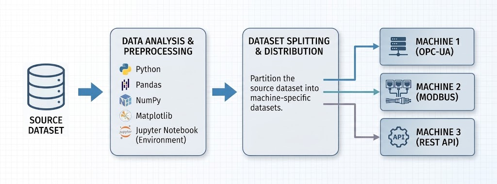

# IIoT Data Simulation & Pipeline Project

## 📌 Project Overview
This project serves as a comprehensive **Industrial IoT (IIoT)** simulation pipeline designed to demonstrate core skills in data engineering, industrial communication protocols, and real-time visualization. 

The system ingests open-source real-world datasets, processes them using Python, simulates real-time data streaming across different industrial protocols, stores the time-series data into **InfluxDB**, and displays live telemetry on **Grafana** dashboards.

---

## 🏗️ Architecture Workflow

The diagram below illustrates the end-to-end data flow of the project:

1. **Source Dataset**: Ingestion of raw open-source data.
2. **Data Analysis & Preprocessing**: Exploratory data analysis, cleaning, and preparation using Python (`Pandas`, `NumPy`, `Matplotlib`) inside a Jupyter Notebook environment.
3. **Dataset Splitting & Distribution**: Partitioning the source dataset into machine-specific datasets.
4. **Industrial Simulation & Protocols**: Transmitting data streams in real-time supporting standard industrial communication standards:
   * **Machine 1**: OPC-UA
   * **Machine 2**: Modbus
   * **Machine 3**: REST API

---

## 🚀 Key Features (Current & Roadmap)

- **Data Pipeline & Preprocessing**: Clean and structure open-source datasets for industrial telemetry simulation.
- **Multi-Protocol Simulation**: Emulate real-world industrial machinery communicating via different protocols (`OPC-UA`, `Modbus`, `REST API`).
- **Time-Series Database**: Efficient storage of high-frequency sensor and machine data using **InfluxDB**.
- **Real-Time Monitoring**: Interactive dashboards built with **Grafana** for live status tracking.

### 🔮 Future Improvements & Roadmap
- [ ] **Machine Learning Integration**: Train ML models (e.g., using historical data) to generate predictive or synthetic sensor readings.
- [ ] **Cloud Deployment**: Containerize the pipeline using Docker and deploy it to a cloud provider (AWS/Azure/GCP).
- [ ] **Anomaly Detection**: Implement automated alerts for out-of-range sensor values.

---

## 🛠️ Tech Stack
- **Language**: Python (`Pandas`, `NumPy`, `Matplotlib`, `Jupyter`)
- **Protocols**: OPC-UA, Modbus, REST API
- **Database**: InfluxDB
- **Visualization**: Grafana

---

## 📝 Getting Started (Coming Soon)
Instructions on how to set up the environment, run the simulation scripts, and configure Grafana dashboards will be added as the project develops.

## 📄 License
This project is open-source and available under the [MIT License](LICENSE).

